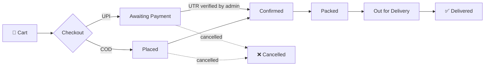

<div align="center">


# Patel Farsan · પટેલ ફરસાણ

**A full-stack online store for a traditional Gujarati farsan shop: browse, order, pay by UPI, and track every order from kitchen to bus pickup.**

[](https://nextjs.org)
[](https://react.dev)
[](https://www.typescriptlang.org)
[](https://tailwindcss.com)
[](https://supabase.com)
[](#-progressive-web-app)

[Features](#-features) · [Tech Stack](#-tech-stack) · [Getting Started](#-getting-started) · [Environment](#-environment-variables) · [Architecture](#-architecture) · [Deployment](#-deployment)

</div>

---

## ✨ Overview

Patel Farsan moves a family-run snack shop online. Customers sign up with an emailed one-time code, fill a cart with weighted price tiers (250 g, 500 g, 1 kg…), check out with **UPI** or **cash on delivery**, and follow their order live. Orders ship by bus to the customer's city.

The shop owner runs everything from a secured **admin panel**: products and stock, delivery cities, order fulfilment, UPI payment checks, customer feedback, email logs, a full audit trail, and a one-click **shop open/closed** switch.

## 🚀 Features

### For customers

| | |
|---|---|
| 🛍️ **Bilingual catalogue** | Products in English and Gujarati, with categories, filters, and per-weight price tiers |
| 🛒 **Persistent cart** | Kept on the device and synced to the account; stock-aware quantity limits |
| 📍 **City-based delivery** | Per-city delivery charge, minimum order weight, and delivery estimate |
| 💳 **UPI & COD checkout** | UPI QR + deep link with UTR submission, or cash on delivery |
| 📦 **Live order tracking** | Realtime status stepper from *Placed* to *Delivered*, plus guest tracking by order number |
| 🔔 **Push notifications** | Phone alerts when an order is confirmed or changes status |
| ✉️ **Email confirmations** | Branded order-confirmation emails sent through Brevo |
| 💬 **WhatsApp ordering** | Pre-filled WhatsApp order messages to the shop |
| ⭐ **Feedback & reviews** | Star ratings; approved reviews appear on the landing page |
| 📱 **Installable app** | Works as a PWA with an offline fallback page |

### For the shop owner

| | |
|---|---|
| 🔐 **Step-up admin login** | Password **and** an emailed 6-digit code; admin sessions expire after 8 hours |
| 📋 **Order management** | Move orders through the status flow, verify or reject UPI payments, cancel with a reason, print slips |
| 🧾 **Products & categories** | Full CRUD with image upload, price tiers, stock, and availability toggles |
| 🏙️ **Delivery cities** | Manage charges, minimum weights, and delivery estimates |
| 🏪 **Open / closed switch** | Close the shop with a custom message; the storefront shows a banner and **new orders are blocked** |
| 📊 **Audit log** | Every admin action recorded with who, what, and when |
| 📨 **Email log** | Delivery history of every transactional email |
| 🛎️ **New-order alerts** | Instant push and email notification for each new order |

## 🧰 Tech Stack

| Layer | Technology |
|---|---|
| **Framework** | [Next.js 16](https://nextjs.org) (App Router, Route Handlers, `unstable_cache`) |
| **UI** | React 19, Tailwind CSS 4, shadcn/ui, Radix UI, Lucide icons, Sonner toasts |
| **State & forms** | Zustand, React Hook Form, Zod |
| **Backend** | Supabase: Postgres with Row-Level Security, Auth, Storage, Realtime |
| **Email** | [Brevo](https://brevo.com) transactional API |
| **Push** | Web Push (VAPID) via `web-push` and a custom service worker |
| **Rate limiting** | Upstash Redis sliding window, with an in-memory fallback |
| **Payments** | UPI QR codes (`qrcode`, `react-qr-code`) with manual UTR verification |

## 🏁 Getting Started

### Prerequisites

- **Node.js** 20 or newer and **npm**
- A free **[Supabase](https://supabase.com)** project
- *(Optional)* a **[Brevo](https://brevo.com)** account for email and an **[Upstash](https://upstash.com)** Redis database for rate limiting

### 1. Clone and install

```bash
git clone https://github.com/dhruvpatel2440/Patel-Farshan.git
```

```bash
cd Patel-Farshan
```

```bash
npm install
```

### 2. Configure environment

```bash
cp .env.local.example .env.local
```

Fill in the values; see [Environment Variables](#-environment-variables) below.

### 3. Set up the database

Run every file in [`supabase/migrations/`](supabase/migrations) **in numeric order** (`0001` → `0019`). Use the Supabase SQL editor or the CLI:

```bash
npx supabase db push
```

`0002_seed.sql` loads starter categories, products, and cities.

### 4. Create an admin

Register a normal account through the app, then promote it in the Supabase SQL editor:

```sql
update public.profiles set role = 'admin' where email = 'you@example.com';
```

Sign in to the admin panel at **`/admin-login`**.

### 5. Run it

```bash
npm run dev
```

Open **http://localhost:3000**.

### Scripts

| Command | Description |
|---|---|
| `npm run dev` | Start the development server |
| `npm run build` | Create a production build |
| `npm run start` | Serve the production build |
| `npm run lint` | Run ESLint |

## 🔑 Environment Variables

| Variable | Required | Description |
|---|:---:|---|
| `NEXT_PUBLIC_SUPABASE_URL` | ✅ | Supabase project URL |
| `NEXT_PUBLIC_SUPABASE_ANON_KEY` | ✅ | Supabase anon (public) key |
| `SUPABASE_SERVICE_ROLE_KEY` | ✅ | Service-role key, **server only** |
| `ADMIN_SESSION_SECRET` | ✅ | Signs the admin step-up cookie (`openssl rand -hex 32`) |
| `OTP_PEPPER` | ✅ | Secret mixed into one-time-code hashes (`openssl rand -hex 32`) |
| `NEXT_PUBLIC_SITE_URL` | ✅ | Public base URL of the site |
| `NEXT_PUBLIC_UPI_ID` | ✅ | UPI ID that receives payments |
| `NEXT_PUBLIC_SHOP_NAME` | | Display name (default `Patel Farsan`) |
| `NEXT_PUBLIC_SHOP_PHONE` | | Shop phone number |
| `NEXT_PUBLIC_SHOP_WHATSAPP` | | WhatsApp number, digits only with country code |
| `BREVO_API_KEY` | | Enables transactional email |
| `BREVO_SENDER_EMAIL` / `BREVO_SENDER_NAME` | | A sender verified in Brevo |
| `CONTACT_TO_EMAIL` | | Inbox for contact-form messages (defaults to the sender) |
| `NEXT_PUBLIC_VAPID_PUBLIC_KEY` / `VAPID_PRIVATE_KEY` | | Web Push keys (`npx web-push generate-vapid-keys`) |
| `VAPID_SUBJECT` | | `mailto:` contact for push services |
| `UPSTASH_REDIS_REST_URL` / `UPSTASH_REDIS_REST_TOKEN` | | Shared rate limiting in production |

> [!WARNING]
> Never commit `.env.local`. Rotating `ADMIN_SESSION_SECRET` logs every admin out. Rotating the VAPID keys breaks every existing push subscription.

## 🏗️ Architecture

### Order lifecycle



On order placement the server **re-reads** prices, stock, city charges, and the shop's open/closed state. It never trusts the client's values. Stock is decremented conditionally per tier, and a failed decrement rolls the whole order back.

### Project structure

```text
src/
├── app/
│   ├── (user)/          # Storefront: landing, products, checkout, about, contact
│   ├── (dashboard)/     # Signed-in area: cart, orders, tracking, account
│   ├── (auth)/          # Login, register, forgot password (email OTP)
│   ├── (admin)/admin/   # Admin panel: orders, products, cities, users, audit…
│   ├── admin-login/     # Step-up admin sign-in
│   └── api/             # Route handlers (orders, auth, admin, push, upload…)
├── components/          # UI grouped by domain (product, order, checkout, pwa, ui…)
├── hooks/               # useAuth, useShopStatus, useRealtimeOrder, usePushNotifications…
├── lib/                 # Supabase clients, email, push, OTP, rate limit, audit, WhatsApp
├── store/               # Zustand cart store
├── types/               # Shared TypeScript types
└── proxy.ts             # Request proxy: session refresh & route protection
supabase/migrations/     # Ordered SQL migrations (schema, RLS, seed data)
public/sw.js             # Service worker: push handling & offline fallback
stages/                  # Step-by-step build guides
```

### 🛡️ Security highlights

- **Row-Level Security** on every table; privileged writes go only through server routes using the service-role client.
- **Two-factor admin access**: a customer session with `role = 'admin'` is not enough to open `/admin`.
- **Peppered, hashed OTPs** that expire, with OTP email subjects redacted in logs.
- **Unguessable order numbers** for public tracking links.
- **Rate limiting** on public and auth endpoints.
- **Server-side price, stock, and shop-status checks** on every order.

## 📲 Progressive Web App

The app ships a web manifest, maskable icons, and a service worker. Customers can **install it to their home screen**, get **push notifications** for order updates, and see a friendly **offline page** when the connection drops.

## ☁️ Deployment

The app is built for **[Vercel](https://vercel.com)**:

1. Import the repository into Vercel.
2. Add every variable from the [Environment Variables](#-environment-variables) table. Set `NEXT_PUBLIC_SITE_URL` to your production domain.
3. In Supabase → **Authentication → URL Configuration**, add the production URL and `/api/auth/callback` as redirect URLs.
4. Add Upstash credentials so rate limits hold across serverless instances.
5. Deploy. 🎉

## 📄 License

Proprietary. © Patel Farsan. All rights reserved.

<div align="center">

<sub>Made with ❤️ for authentic Gujarati farsan.</sub>

</div>
